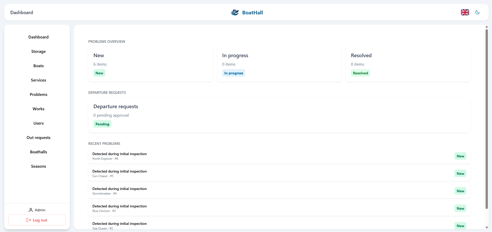
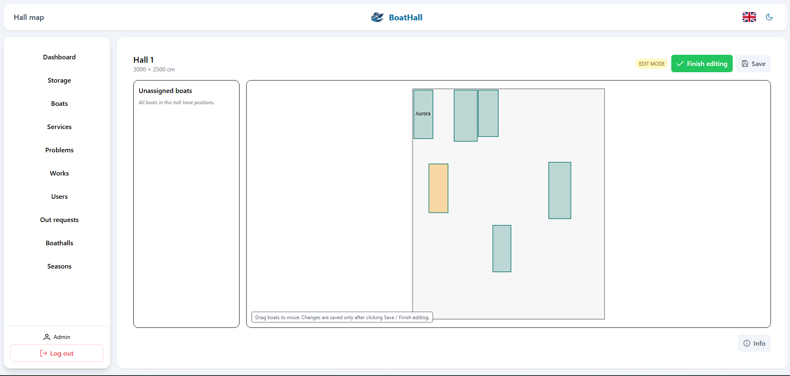
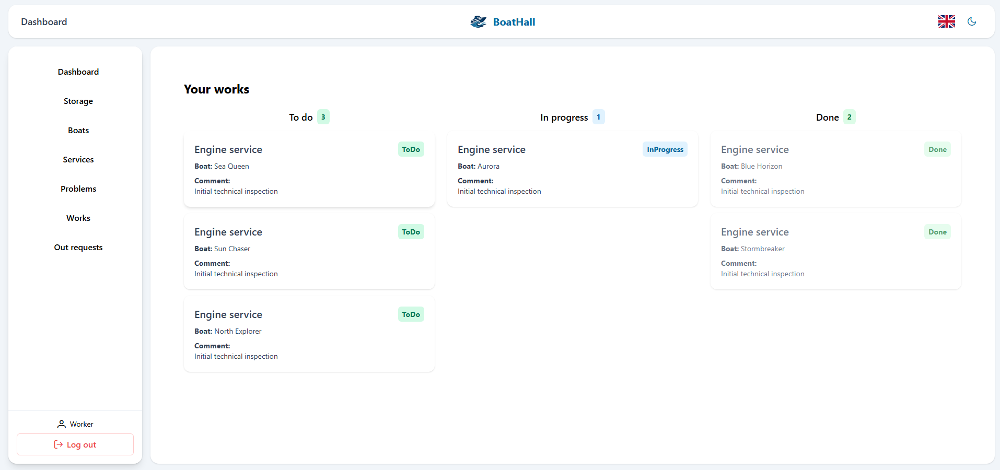
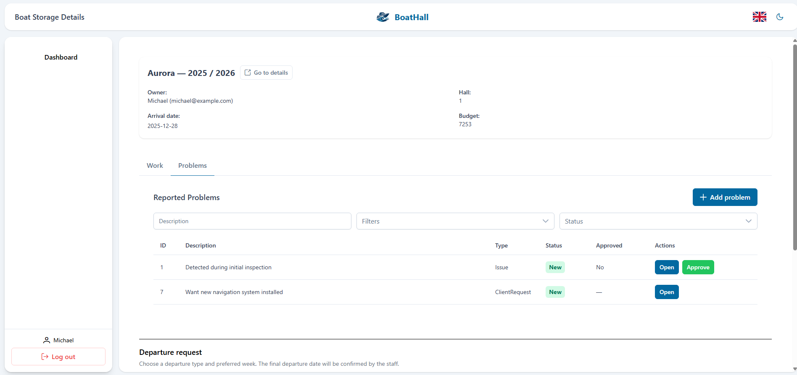
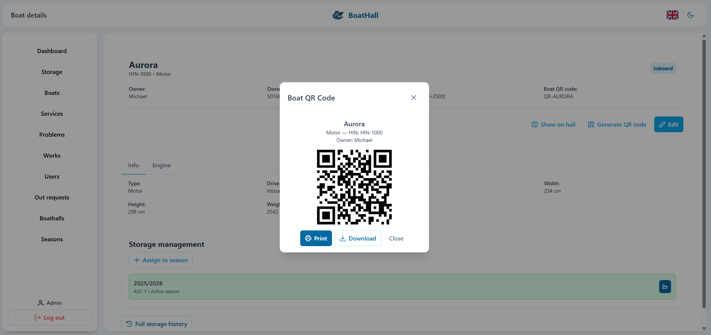

# BoatHall — Boat Storage Management System

BoatHall is a full-stack web application built as an **individual Computer Science engineering thesis project**. It is designed to help a boat storage business organize customer records, boats, storage seasons and hall space, as well as maintenance work and collection requests.

**Status:** Academic/portfolio project. The supplied Docker setup is intended for local demonstration, not deployment as a public production service.

## Features

- **Role-specific interfaces** for administrators, employees and customers.
- **Boat and customer records**, including dimensions, engine details and boat-specific information.
- **Storage seasons and records** to track when and where boats are stored.
- **Interactive hall layout** for positioning boats and checking space constraints and collisions.
- **Maintenance management**, including problems, services, tasks and work history.
- **Boat collection requests** and related workflows.
- **QR codes** for navigating to boat records and **PDF exports** for selected data.
- **English and Swedish** user interface translations.
- **Backend unit tests** for controller logic.

## Tech stack

| Area | Technologies |
| --- | --- |
| Frontend | Vue 3, JavaScript, Vite, Pinia, Vue Router, PrimeVue, Tailwind CSS |
| Backend | Node.js, Express, Sequelize |
| Database | MySQL / MariaDB |
| Authentication | JWT, HTTP-only cookies, bcrypt |
| Testing | Jest |
| Infrastructure | Docker, Docker Compose |
| Other libraries | OpenLayers, QR code generation, jsPDF, vue-i18n |

## Architecture

```text
Browser (Vue 3 / Vite)
       |
       | HTTP / JSON
       v
Express REST API
       |-- Routes and authentication middleware
       |-- Controllers and business logic
       |-- Sequelize data models
       v
MySQL database
```

The Docker development environment starts separate **database**, **backend** and **frontend** services.

## Project structure

```text
Backend/
  Controllers/     Business logic and request handlers
  Database/        Database connection and demo seed data
  Middleware/      Authentication middleware
  Models/          Sequelize data models
  Routes/          API routes
  Tests/           Backend unit tests
  app.js           Backend entry point
Frontend/
  src/components/  Reusable UI components
  src/views/       Application screens
  src/services/    API integration
  src/stores/      State management
  src/I18n-Language/ English and Swedish translations
Dockerfile         Backend Docker image
Frontend/Dockerfile.dev
                  Frontend development Docker image
docker-compose.demo.yml
                  Local demo services
scripts/run-demo.js
                  Demo launcher
```

## Running locally with Docker

**Prerequisites:** Docker with the Compose plugin, plus Node.js/npm if using the `npm run demo` launcher.

1. Create `.env.docker` in the project root using the safe `.env.docker.example` template. Replace the example JWT/session secrets with fresh random values. **Do not commit `.env.docker`.**
2. The provided demo Compose configuration uses a disposable MySQL development database. Ensure the database settings in `.env.docker` match `docker-compose.demo.yml`.
3. From the root, run:

   ```bash
   docker compose -f docker-compose.demo.yml up --build
   ```

   Or, with Node.js installed:

   ```bash
   npm run demo
   ```

4. Open the frontend at `http://localhost:5173`. The backend health check is available at `http://localhost:3000/api/health`.

**Important:** The development configuration binds ports to the host network and uses demo credentials. Keep it on a trusted local machine/network; do not expose it to the internet. The named MySQL volume retains database data until explicitly removed.

## Backend tests

Install dependencies in the project root and run:

```bash
npm install
npm test
```

Tests may require separate test database configuration. Their execution was not independently verified during this code review.

## Screenshots

The following screenshots are from the engineering thesis demonstration, using example boats and accounts. They show the actual implemented user interface; the application is not hosted as a public live demo.

### Administrator dashboard

Overview of reported issues, departure requests and recent activity.



### Interactive hall editor

Visualization of hall space and drag-and-drop placement of boats.



<details>
<summary>More screenshots: employee workflow, customer issue reporting and QR codes</summary>

#### Employee task board



#### Customer issue reporting



#### Boat QR code generation



</details>

## Project scope

This project demonstrates end-to-end development: user interfaces, server-side business logic, REST APIs, relational data modeling, application state management, testing and containerized local setup. It was developed as an individual engineering thesis.

**Limitations:** This remains an academic demonstration. Authorization and account-recovery flows need additional hardening and testing before any real-world deployment.### Copyright & Usage

Copyright © 2025–2026 Maciej Wiśniewski. All rights reserved.

BoatHall is an individual engineering thesis project made publicly available for portfolio and educational review purposes.

The original source code is proprietary and is not licensed for reuse, modification, or redistribution without prior permission from the copyright holder, except as permitted by applicable law and GitHub's Terms of Service.

Third-party libraries and components remain subject to their respective licenses.
